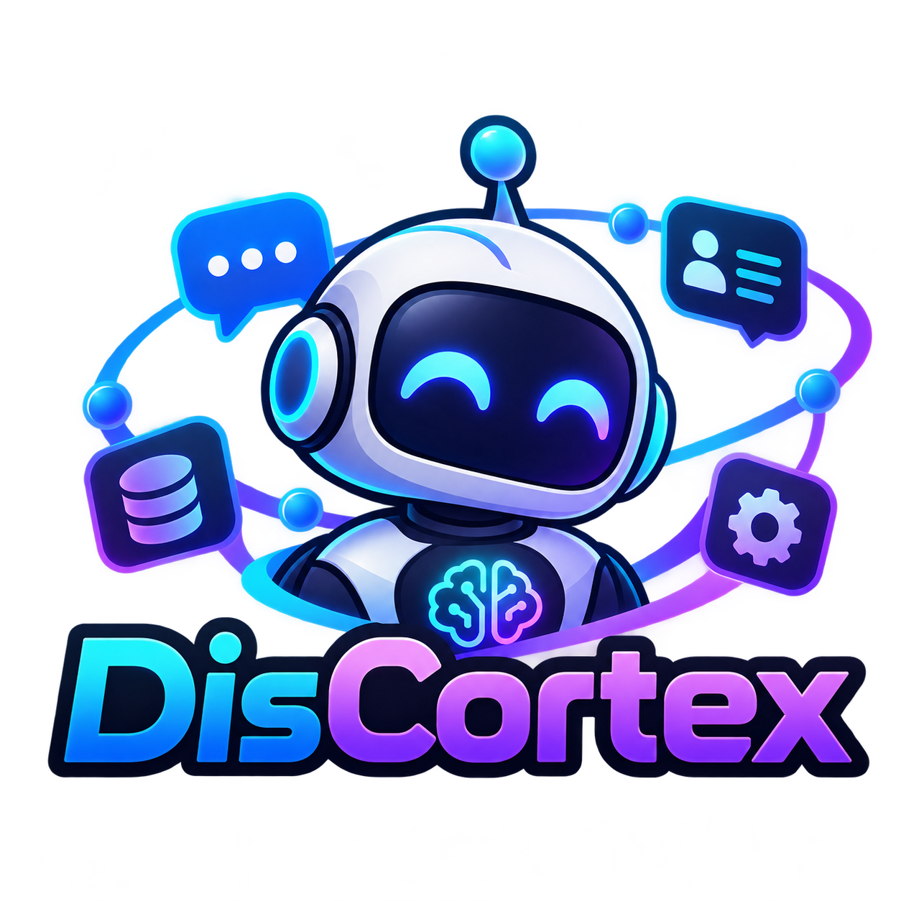

<p align="center">
  
</p>

<h1 align="center">DisCortex</h1>

<p align="center">
  <b>Portable Discord AI Host</b><br>
  <i>Different brains. Different personalities. One memory.</i>
</p>

---

DisCortex is a Windows desktop app that connects Discord **text** channels to an
[Ollama](https://ollama.com) language model running on the same PC, on another machine on your
network, or behind a VPN. While you're away, your bot reads the channels you choose and replies
in character. It remembers the people it talks to.

It uses an official **Discord bot account** (a bot token). It never automates a user account
(no "self-bot").

## Features

- **Bot profiles.** Each profile is a persona: a system prompt, trigger words, behaviour
  settings, the channels it watches, and the Ollama server and model that power it. One profile
  is active at a time, and you can switch live from the dashboard without restarting.
- **Shared, permanent memory.** Every message in a watched channel is stored in one local SQLite
  database, searchable by keyword (FTS5) and by meaning (Ollama embeddings). After the bot replies
  to someone, it extracts lasting facts about that person in the background ("lives in Ohio",
  "mains a Glock"), and it writes a short summary once it has enough of them. **Every profile shares the
  same memory and user profiles**, so switching personas or Ollama servers never loses anything.
- **Two reply modes.**
  - **Trigger:** replies only when a trigger word is used, when the bot is @mentioned, or when
    someone replies to the bot.
  - **All:** replies to every message in the watched channels.
- **Sticky conversations.** In Trigger mode, a trigger *engages* that person. They can keep
  chatting without repeating the trigger word. The bot drops out when they go quiet, @mention or
  reply to someone else, start a message with someone else's name, or say something like
  "not you" or "go away". A sign-off like "thanks …" gets one short goodbye.
- **GUI.** A dashboard with a big ON/OFF switch, mode toggle, status and a live colour-coded log.
  A profile editor with **Test connection** and a model list from the server, a user-profiles
  browser (view and edit what the bot knows, wipe a user, channel, or everything), and settings.
- **Tray icon and global hotkeys.** Turn the bot on or off and switch mode from inside a game.
- **Portable.** Config, profiles and memory all live in the app folder. Copy the folder to
  another PC or a USB stick and the bot comes with it. It runs from any drive letter.
- **Remote brains.** Point any profile at `localhost`, a LAN box (e.g. a Jetson), or an https
  reverse proxy with an optional bearer-token API key.
- Reasoning models are supported: `<think>…</think>` blocks are stripped from replies.

## Requirements

- **Windows 10 or 11**
- **[Ollama](https://ollama.com)** on this PC or another machine you can reach, with at least
  one chat model and the embedding model pulled:
  ```
  ollama pull llama3.1:8b          # or any chat model you like
  ollama pull nomic-embed-text     # used for memory search
  ```
- **A Discord bot** (see [Discord bot setup](#discord-bot-setup))
- **Python 3.11 or newer**, only if you run from source or build the exe yourself. The
  release `DisCortex.exe` needs no Python.

---

## Contents
1. [Discord bot setup](#discord-bot-setup)
2. [Install](#install)
3. [First run](#first-run)
4. [Configuration](#configuration)
5. [Ollama setup (local, LAN, Jetson)](#ollama-setup-local-lan-jetson)
6. [WAN safety](#wan-safety)
7. [Using DisCortex](#using-discortex)
8. [Files and portability](#files-and-portability)
9. [Running from source](#running-from-source)
10. [Building the exe](#building-the-exe)
11. [Privacy](#privacy)
12. [Troubleshooting](#troubleshooting)

---

## Discord bot setup

1. Go to the [Discord Developer Portal](https://discord.com/developers/applications) →
   **New Application**, and give it a name.
2. Open **Bot**:
   - Press **Reset Token** and copy the token. You'll paste it into DisCortex. Treat it like a
     password: anyone with it controls your bot.
   - Under **Privileged Gateway Intents**, enable **Message Content Intent** and **Server Members
     Intent** (members is used for display names). Without them the bot can't read messages.
3. Invite the bot to your server. Open **OAuth2 → URL Generator**, tick the scope **`bot`**, then
   tick the permissions **View Channels**, **Send Messages** and **Read Message History**. Open
   the generated URL and pick your server. The equivalent link (replace `YOUR_APP_ID` with the
   Application ID from **General Information**) is:
   ```
   https://discord.com/oauth2/authorize?client_id=YOUR_APP_ID&scope=bot&permissions=68608
   ```
4. Make sure the bot can see the channels you want it to watch (channel permissions/roles).

> **Getting a channel ID:** in Discord, User Settings → Advanced → turn on **Developer Mode**.
> Then right-click a channel → **Copy Channel ID**.

---

## Install

### Option A: the prebuilt exe (no Python needed)

1. Download the latest `DisCortex-*.zip` from the
   [Releases](../../releases) page and extract it anywhere: a folder, another drive, a USB stick.
2. Double-click **`start.bat`**.

### Option B: from source

1. Install Python 3.11+ from [python.org](https://www.python.org/downloads/) and tick
   **"Add python.exe to PATH"**.
2. Download or `git clone` this repository.
3. Double-click **`setup.bat`**. It creates a `.venv` folder and installs `requirements.txt`.
   It's safe to run again.
4. Double-click **`start.bat`**. With no `DisCortex.exe` in the folder, it runs the app from
   `.venv`.

---

## First run

1. DisCortex asks for the **Discord bot token**. It is saved in **Windows Credential Manager** on
   this PC only. It is never written to a file and never shown again.
2. On first launch DisCortex creates `config.yaml`, `bot_profiles\dayz.yaml` and
   `bot_profiles\general.yaml` from the shipped `*.example.yaml` files, plus empty `data\` and
   `logs\` folders.
3. Open the **Profiles** tab and edit a profile (or press **New**):
   - Set the Ollama URL (default `http://localhost:11434`) and press **Test connection**. The
     **Model** list fills with that server's models. Pick one.
   - Write the persona (system prompt), set the trigger words and mode.
   - **Replace the placeholder channel ID** `123456789012345678` with your channel ID(s).
   - Press **Save**, then **Load this profile now**.
4. On the **Dashboard**, check the status: Discord *connected*, Ollama *reachable*.
5. Press the big **OFF** button to turn it **ON**. DisCortex always starts **OFF**.

Test in a private server/channel first.

---

## Configuration

Everything can be configured from the GUI. Editing YAML by hand is optional.

**`config.yaml`** holds global settings that apply to every profile:

```yaml
last_profile: general          # profile loaded at startup
embed_model: nomic-embed-text  # Ollama model used for memory search
enabled: false                 # master on/off at startup
start_minimized: false         # start hidden in the tray
hotkey_sound: true             # beep when a global hotkey is used
hotkeys:
  toggle_enabled: <ctrl>+<alt>+a
  toggle_mode: <ctrl>+<alt>+m
```

**`bot_profiles\<name>.yaml`** holds one bot profile each. The main keys are:

| Key | Meaning |
|---|---|
| `name` | profile name |
| `ollama_url` | `http://localhost:11434`, a LAN address, or an `https://` URL |
| `ollama_api_key` | optional; sent as `Authorization: Bearer <key>` (for a reverse proxy) |
| `model` | chat model on that server |
| `temperature` | sampling temperature |
| `system_prompt` | the persona |
| `channel_ids` | channels to watch |
| `mode` | `trigger` or `all` |
| `triggers` | trigger words/phrases (case-insensitive, whole word) |
| `respond_to_mentions`, `respond_to_replies` | also trigger on @mentions / replies to the bot |
| `context_messages` | recent channel messages sent as context |
| `cooldown_seconds` | per-channel cooldown between replies |
| `max_reply_chars` | reply length cap |
| `sticky_engage`, `engage_timeout_seconds` | sticky conversations on/off, and the silence timeout |
| `disengage_phrases`, `signoff_phrases` | phrases that end an engagement (sign-offs get a goodbye) |
| `memory_enabled`, `memory_k`, `memory_max_chars` | memory retrieval on/off, results per search, prompt budget |
| `prefer_current_channel` | rank same-channel memories higher (never hides other channels) |

Missing keys fall back to defaults, so older profiles keep working. See
`bot_profiles\*.example.yaml` for full examples.

The **bot token is not in any of these files**. It lives in Windows Credential Manager. The
real `config.yaml` and `bot_profiles\*.yaml` are git-ignored; only the `*.example.yaml` files
are in the repository.

---

## Ollama setup (local, LAN, Jetson)

Each bot profile has its own **Ollama URL**, so different personas can use different machines.
On every machine you use, pull the chat models the profiles need **plus the embed model**. The
embed model is the same one for every profile.

If the embed model is missing on a server, DisCortex warns you and falls back to keyword-only
memory search; it keeps working.

### Same PC
Install Ollama, pull the models, and use `http://localhost:11434` (the default).

### Another PC on your LAN (Windows)
By default Ollama only listens to its own machine. On the **Ollama machine**:
1. Set a user environment variable `OLLAMA_HOST` = `0.0.0.0`
   (Settings → System → About → Advanced system settings → Environment Variables), then quit
   Ollama from its tray icon and start it again.
2. Allow port 11434 through Windows Firewall (PowerShell as administrator), private networks only:
   ```powershell
   New-NetFirewallRule -DisplayName "Ollama (LAN)" -Direction Inbound -Protocol TCP -LocalPort 11434 -Action Allow -Profile Private
   ```
3. In the DisCortex profile, set the URL to that machine's LAN address, e.g.
   `http://192.168.1.50:11434`, and press **Test connection**.

### Jetson / Linux box
Ollama runs as a systemd service. On that machine:
```bash
sudo systemctl edit ollama
#   add these two lines in the editor, then save:
#   [Service]
#   Environment="OLLAMA_HOST=0.0.0.0:11434"
sudo systemctl daemon-reload
sudo systemctl restart ollama
# if ufw is enabled, allow your LAN only, e.g.:
sudo ufw allow from 192.168.1.0/24 to any port 11434 proto tcp
```
Then point a profile at `http://<machine-ip>:11434`. From the DisCortex PC you can check it with
`curl http://<machine-ip>:11434/api/tags`.

The first reply after loading a model can take a while because the model has to load into
memory. DisCortex waits up to a few minutes for it.

---

## WAN safety

> **Ollama has NO authentication.** Anyone who can reach port 11434 can use your GPU, pull
> models and fill your disk. **Never port-forward 11434 to the internet.**

To use an Ollama box outside your home network, use one of these:
- **A VPN:** [Tailscale](https://tailscale.com), WireGuard or SoftEther. Point the profile at the
  machine's VPN address (e.g. `http://100.x.y.z:11434`). This is the simplest option.
- **An https reverse proxy with authentication** (e.g. Caddy or nginx with a bearer token in
  front of Ollama). Put the URL (`https://ollama.example.com`) and the token in the profile's
  **API key** field; DisCortex sends it as `Authorization: Bearer <key>`. The API key is stored
  in plain text in that profile's YAML file, so keep the folder private.

---

## Using DisCortex

### Dashboard
- **ON / OFF:** the master switch. When OFF the bot ignores everything. It doesn't even store
  messages.
- **Mode:** All or Trigger. Switching here overrides the profile's mode until you switch profile.
- **Bot profile + Load:** switch persona/brain live. The bot reconnects with the new profile.
- **Status:** Discord connection, Ollama reachability, model, memory search, engaged users.
- **Live log:** the last 200 events, colour-coded, with Pause and Clear.

### Profiles tab
Create, edit, duplicate and delete bot profiles, with every setting from the table above.
**Save** warns you (but still lets you save) if the server is unreachable, the model isn't on
it, or no channels are set.

### User profiles tab
Everything the bot has learned about the people it talks to, shared by all profiles. You can
search by name or Discord ID, read the summary and facts, delete wrong facts, and add your own
**notes** (the bot sees them). You can also wipe one user, one channel, or all memory (with
confirmation).

### Settings tab
- **Discord bot token:** shows whether one is saved, never the token itself. **Change token…**
  reconnects with the new one.
- **Embed model** (for memory search) and **Re-embed all**.
- **Global hotkeys** with Record, Clear and an optional beep.
- **Start minimized to tray.**

### Tray and hotkeys
Minimising (or **Hide to tray**) keeps DisCortex running in the tray. Right-click the tray icon
for On/Off, Mode, Open and Quit.

| Hotkey | Action |
|---|---|
| **Ctrl+Alt+A** | Turn the bot ON / OFF |
| **Ctrl+Alt+M** | Switch mode All / Trigger |

Hotkeys work while a game has focus. If a game runs **as administrator**, Windows only passes
keys to DisCortex when DisCortex runs as administrator too.

---

## Files and portability

Everything is stored next to `DisCortex.exe` (or in the project folder when running from source):

```
DisCortex.exe          the app
start.bat              normal launcher
start-console.bat      launcher that also shows the live log (troubleshooting)
config.yaml            global settings (created from config.example.yaml on first run)
bot_profiles\          one .yaml file per bot profile (examples: *.example.yaml)
data\memory.db         shared memory: messages, user profiles, facts, notes
logs\bot.log           log file
assets\                logo and icon
```

**To move DisCortex to another PC or a USB stick,** copy the whole folder. Profiles, memory and
user profiles come along. The **Discord token does not**: it lives in that PC's Credential
Manager, so the new PC asks for it once. If a profile points at `localhost` and the new PC has
no Ollama, change the profile's Ollama URL to point at your Ollama box.

> **The `.venv` folder is NOT portable.** A Python virtual environment hardcodes the paths of
> the PC it was made on. On another machine, use **`DisCortex.exe`** (via `start.bat`), which
> needs no Python, or run `setup.bat` there to rebuild `.venv`.

---

## Running from source

```bat
setup.bat          :: creates .venv and installs requirements.txt (safe to rerun)
start.bat          :: no DisCortex.exe present, so it runs .venv\Scripts\pythonw.exe -m app.main
start-console.bat  :: same, but keeps a console window with the log
```

Command-line options (work with `start.bat`, the exe, or `python -m app.main`):

| Option | What it does |
|---|---|
| `--profile NAME` | load this bot profile instead of the last used one |
| `--reset-token` | forget the saved bot token and ask for it again |
| `--console` | text-only fallback with a console profile menu and no window (source only: `.venv\Scripts\python.exe -m app.main --console`) |

Memory maintenance from the command line:
```bat
.venv\Scripts\python.exe -m app.memory_cli stats
.venv\Scripts\python.exe -m app.memory_cli users [search]
.venv\Scripts\python.exe -m app.memory_cli user <id or name>
.venv\Scripts\python.exe -m app.memory_cli search <text>
.venv\Scripts\python.exe -m app.memory_cli notes <id or name> <text>
.venv\Scripts\python.exe -m app.memory_cli wipe-user <id or name>
.venv\Scripts\python.exe -m app.memory_cli wipe-channel <channel id>
.venv\Scripts\python.exe -m app.memory_cli wipe-all
.venv\Scripts\python.exe -m app.memory_cli reembed
```

Project layout:
```
app\main.py         entry point: startup, then GUI (main thread) + bot (background thread)
app\bot.py          discord.py client and message handling
app\llm.py          Ollama client (chat, model list, embeddings)
app\memory.py       SQLite memory and user profiles
app\engagement.py   sticky-conversation logic
app\profiles.py     bot profile load/save/validate
app\gui.py ...      dashboard, profile editor, settings, user profiles, tray
app\hotkeys.py      global hotkeys
```

---

## Building the exe

Run **`build.bat`** (after `setup.bat`). It installs PyInstaller from `requirements-build.txt`,
generates `assets\discortex.ico` from the logo, builds a single-file windowed `DisCortex.exe`,
and puts a clean, ready-to-copy portable folder in **`dist\DisCortex\`**:

```
dist\DisCortex\
  DisCortex.exe  start.bat  start-console.bat  README.md  LICENSE
  config.example.yaml
  bot_profiles\*.example.yaml
  assets\  data\ (empty)  logs\ (empty)
```

The build never includes your `config.yaml`, your bot profiles, `data\memory.db`, logs or the
token. To rebuild into a `dist\DisCortex` folder that has already been used (it contains
`data\memory.db`), `build.bat` stops and asks you to move that folder first, so it never deletes
memory.

---

## Privacy

- **Memory stays local.** Messages, user profiles, facts and notes are stored only in
  `data\memory.db` in the app folder. DisCortex has no telemetry and sends nothing anywhere
  except to Discord and to the Ollama server(s) you configure.
- Message text from watched channels is sent to the Ollama server in the active profile. If
  that server is another machine, the text travels over your network, so use a VPN or https for
  anything outside your LAN.
- The bot token is kept in Windows Credential Manager, never in a file, and is never logged.
- `data\memory.db` contains stored chat messages from your server. Keep the folder private and
  tell your community that the bot remembers conversations.

---

## Troubleshooting

Run **`start-console.bat`** to see the log live while DisCortex runs. The same log is in
`logs\bot.log`.

| Problem | Fix |
|---|---|
| "Discord rejected the bot token" | Settings → **Change token…** and paste a fresh token (Developer Portal → Bot → Reset Token), or start with `--reset-token`. |
| "Enable Message Content Intent…" | Developer Portal → Bot → Privileged Gateway Intents: enable **Message Content** and **Server Members**. |
| Bot is online but never replies | Is the big button **ON**? Is the channel ID in the profile (not the `123456789012345678` placeholder)? In Trigger mode, did you use a trigger word? Check the live log. |
| "Can't reach Ollama at http://…" | Is Ollama running on that machine? For another machine, see [LAN setup](#another-pc-on-your-lan-windows) (`OLLAMA_HOST=0.0.0.0` and firewall). DisCortex keeps retrying. |
| "model … not on this server" | Run `ollama pull <model>` on that machine, or pick another model in the profile. |
| Memory search says "keyword-only" | Run `ollama pull nomic-embed-text` on the profile's Ollama machine. |
| Hotkeys don't work in one game | The game probably runs as administrator: run DisCortex as administrator too, or rebind the hotkey in Settings. |
| First reply is very slow | Normal: the model is loading into memory. Later replies are faster. |

---

## License

See [LICENSE](LICENSE).

---

<p align="center">Created by <a href="https://github.com/shaybee22">James Powell</a></p>
